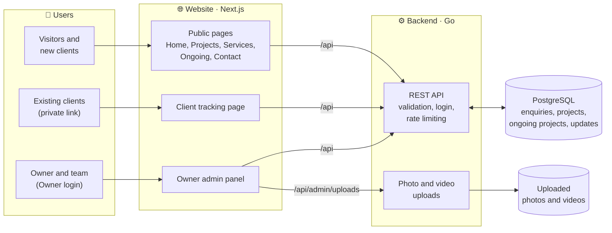
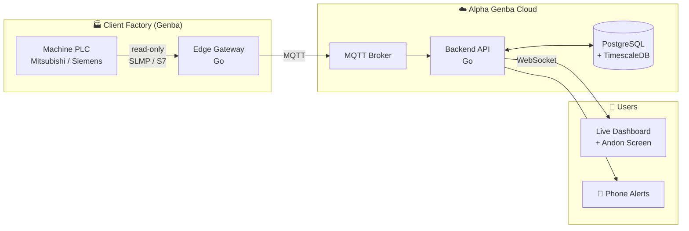
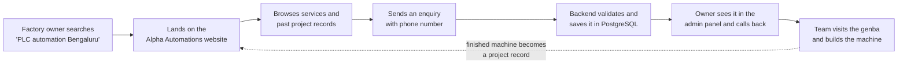
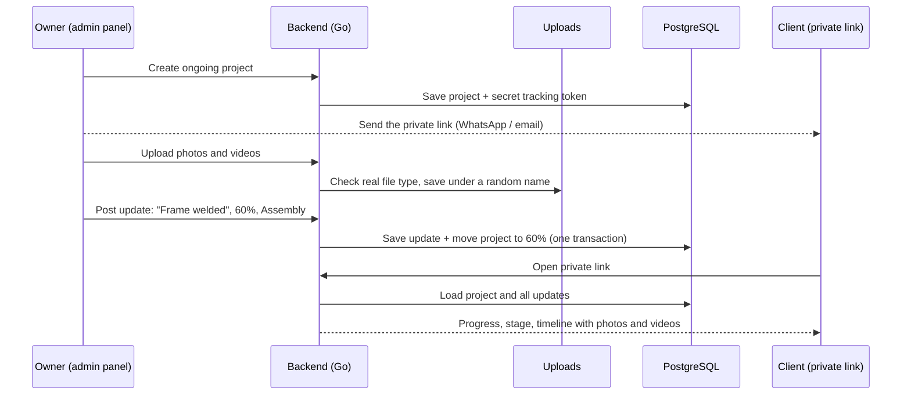
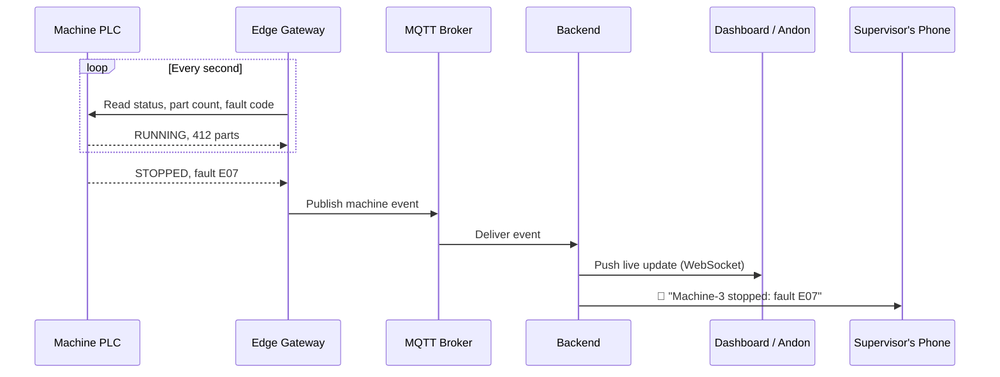

<div align="center">

# Alpha Genba

### Showcase the work. See the shop floor live.

A full-stack industrial software platform built for **Alpha Automations**,<br/>
an industrial automation equipment manufacturer in Bengaluru, India.


</div>

> **Genba (現場)** is a Japanese manufacturing term meaning *"the actual place"*, the shop floor where real work happens. It comes from the Toyota Production System, where problems are solved by going to the genba and seeing them first-hand.

---

## Why This Project Exists

**Alpha Automations** designs and manufactures complete automated and semi-automated machines and PLC-controlled electrical control panels for industries of every kind. Their approach is genba-first: the team goes to the client's shop floor, studies the real difficulty, and builds a machine that solves it, for **consistency** and **maximum output**.

But two problems remain once the hardware is built:

| Problem | Impact |
|---|---|
| The company's work is not visible online | New clients cannot see what Alpha Automations has built or what it can do |
| Once a machine is installed, nobody sees how it performs | Stoppages go unnoticed, quality issues are not tracked, output is lost |

**Alpha Genba solves both, in one platform.**

---

## The Platform

<table>
<tr>
<td width="50%" valign="top">

### 🌐 Part 1: Company Website · ✅ Built

For **new clients**, **existing clients** and the **Alpha Automations team**

- Services and capabilities
- **Project records**: every machine delivered, with the genba problem, the solution built, and photos
- **Ongoing projects**: live progress %, stage, photos and videos of machines being built
- **Private client links**: each client follows their own machine
- **Request a quote**: enquiries go straight to the team
- **Owner admin panel**: manage everything without code

</td>
<td width="50%" valign="top">

### 🏭 Part 2: Live Monitoring · 🔜 Planned

For **clients** running Alpha Automations machines

- **Live machine status**: running, stopped, faulted
- **Digital Andon**: instant alert when a line stops
- **OEE**: Availability × Performance × Quality
- **Poka-Yoke and quality logs**
- **Production reports**: output, cycle time, downtime

</td>
</tr>
</table>

---

## Features

### For visitors and new clients

| Page | What it offers |
|---|---|
| **Home** | Who Alpha Automations is, capabilities, the genba approach, recent and ongoing projects, technologies |
| **Projects** | Every completed machine: the problem at the genba → what was built → the result, with a photo gallery |
| **Services** | What automation does for a factory, all 10 services explained (what it is, what you get, typical uses), industries, FAQ |
| **Ongoing Projects** | Machines being built right now, with progress, stage tracker, and a timeline of photo and video updates |
| **Contact** | Phone, email, address with map link, and an enquiry form |

### For existing clients

- A **private link** to their own project: progress percentage, current stage (Design → Manufacturing → Assembly → Testing → Installation → Completed), and every update with photos and videos
- Works even when the project isn't public, and is never shown on Google

### For the owner and team (Owner login)

| Tab | What you can do |
|---|---|
| **Client enquiries** | See every enquiry, filter by status (New, Contacted, Won, Lost, Archived), call or email in one click, keep private team notes |
| **Ongoing projects** | Create a project, post progress updates with photos and videos (live upload progress bar), copy the client's private link, choose public or private |
| **Completed projects** | Add finished machines with a main photo, gallery, problem / solution / result, and publish them to the website |

### Experience

- Industrial design: sky blue and white, an engineering typeface, large readable text
- Smooth page transitions, scroll animations, full-screen photo and video viewer
- Works on phones, tablets and desktops
- Ready for Google: page titles, sitemap, robots rules, site icon and structured company details

---

## System Architecture

### Today

The website and the backend share **one database**. The browser talks only to the website, which forwards every `/api` request to the Go backend.



### Planned: live machine monitoring



The factory simulator in `simulator/` (machines, faults and real OEE maths, with tests) is the first building block for this part.

---

## How It Works

### Flow 1: A new client finds Alpha Automations



### Flow 2: A client follows their machine being built



### Flow 3 (planned): A machine stops on the shop floor



If the factory internet goes down, the gateway will store data locally and send it in order once the connection is back, so no data is lost.

---

## Engineering Highlights

### Built

| Challenge | Approach |
|---|---|
| **One system, three audiences** | A shared Go backend serves visitors, clients (private links) and the owner (admin panel) |
| **Private client links** | Random 32-character tokens, never included in public API responses, hidden from search engines |
| **Safe file uploads** | File type detected from the file's contents (not its name), size limits (10 MB photos, 300 MB videos), random file names, files deleted with their project |
| **Large video uploads** | Upload progress bar, extended server time limits, proxy body limit raised from the 10 MB default |
| **Consistent data** | Database constraints (e.g. progress 0–100) and transactions (an update and the project's progress change together) |
| **Secure owner login** | HMAC-signed HttpOnly cookies, constant-time password check, rate limiting against password guessing |
| **Spam-resistant enquiry form** | Validation, rate limiting and a hidden honeypot field |
| **Fast, smooth pages** | Server rendering with streaming (`Suspense`), page transitions, scroll animations that never hide on-screen content |
| **Zero-install development** | The backend starts its own PostgreSQL automatically (UTF-8, so Kannada, Hindi and Japanese text work) |
| **Built on real manufacturing concepts** | Genba, Andon, Poka-Yoke and OEE from lean manufacturing and the Toyota Production System |

### Planned

| Challenge | Approach |
|---|---|
| **Talking to industrial hardware** | Edge gateway reads Mitsubishi PLCs (SLMP / MC protocol) and Siemens PLCs (S7) |
| **Safety on live production lines** | The platform will be **read-only**: it never writes to a PLC |
| **Unreliable factory internet** | Store-and-forward buffering on the gateway |
| **Real-time updates** | MQTT from machines, WebSockets to the dashboard |
| **Large volumes of machine data** | Time-series storage with TimescaleDB |

---

## Tech Stack

### Built with

| Layer | Technology | Used for |
|---|---|---|
| **Frontend** | TypeScript, React 19, Next.js 16 | Pages, routing, server rendering for Google, page transitions |
| **Styling** | Tailwind CSS 4, IBM Plex Sans, lucide-react icons | Industrial design that works on phones and desktops |
| **Backend** | Go 1.27 (standard library `net/http`) | REST API, owner login, photo and video uploads, private client links |
| **Database** | PostgreSQL 17 (via `pgx`, with `embedded-postgres` for development) | Enquiries, completed projects, ongoing projects and progress updates |
| **Security** | HMAC-signed cookies, rate limiting, input validation, file-type checks | Protecting the admin panel, forms and uploads |
| **Search (SEO)** | Next.js metadata, sitemap, robots rules, structured data | Getting found on Google |
| **Testing** | Go tests, TypeScript type checks, ESLint, production builds | Automatic checks before every change |
| **Tools** | Git, GitHub, VS Code, npm, Node.js | Version control and development |

### Planned (for live machine monitoring)

| Technology | Purpose |
|---|---|
| Go edge gateway | Read data from Mitsubishi and Siemens PLCs (read-only) |
| MQTT | Send machine data reliably from the factory floor |
| WebSockets | Instant live updates on the dashboard |
| TimescaleDB | Store large amounts of machine data over time |
| Docker, GitHub Actions | Deployment and automatic testing |

---

## Project Structure

```
alpha-genba/
├── backend/     # Go: REST API, owner login, uploads, ongoing projects, PostgreSQL access
├── simulator/   # Go: factory simulator (machines, faults, OEE) for future live monitoring
├── web/         # Next.js: company website, client tracking pages, owner admin panel
├── docs/        # Development guide: how everything was built, step by step
├── gateway/     # (planned) Go: edge gateway that reads real PLC data
└── deploy/      # (planned) Docker and deployment configuration
```

---

## Run It Locally

You need **Go** and **Node.js**. PostgreSQL does **not** need to be installed: in development the backend downloads and starts its own PostgreSQL automatically (data is kept in `.devdata/`).

**1. Set the owner password** (first time only)

```bash
cp backend/.env.example backend/.env
```

Then open `backend/.env` and choose an `ADMIN_PASSWORD`. This file is ignored by Git.

**2. Start the backend** (terminal 1, from the repository root)

```bash
go run ./backend
```

The API runs on http://localhost:8080. Stop it with **Ctrl + C** so the database shuts down cleanly.

**3. Start the website** (terminal 2)

```bash
cd web
npm install
npm run dev
```

Open http://localhost:3000 and use **Owner login** in the top menu to reach the admin panel.

| Page | What it is |
|---|---|
| `/` | Home: about Alpha Automations, capabilities, genba approach, services, recent and ongoing projects |
| `/projects` | Completed projects with photo galleries, managed from the admin panel |
| `/services` | What automation does for clients: benefits, every service explained, industries, FAQ |
| `/ongoing` | Machines being built now: progress %, stage, photo and video updates |
| `/track/{link}` | A client's private page for their own project (shared by the team) |
| `/contact` | Company contact details and enquiry form |
| `/admin` | Owner login and admin panel: enquiries, ongoing projects, completed projects |

**Run the tests**

```bash
go test ./...
```

---

## API

| Method | Path | Access |
|---|---|---|
| `GET` | `/api/health` | Public |
| `GET` | `/api/projects`, `/api/projects/{slug}` | Public (published only) |
| `GET` | `/api/ongoing`, `/api/ongoing/{slug}` | Public (public ongoing projects only) |
| `GET` | `/api/track/{token}` | Anyone with the client's private link |
| `GET` | `/api/uploads/{file}` | Public (uploaded photos and videos) |
| `POST` | `/api/enquiries` | Public (validated, rate-limited, spam honeypot) |
| `POST` | `/api/admin/login`, `/api/admin/logout` | Login is rate-limited |
| `GET` / `PATCH` | `/api/admin/enquiries[/{id}]` | Owner (status and team notes) |
| `GET` / `POST` / `PUT` / `DELETE` | `/api/admin/projects[/{id}]` | Owner |
| `GET` / `POST` / `PUT` / `DELETE` | `/api/admin/ongoing[/{id}]` | Owner |
| `POST` / `DELETE` | `/api/admin/ongoing/{id}/updates`, `/api/admin/updates/{id}` | Owner |
| `POST` | `/api/admin/uploads` | Owner (photos up to 10 MB, videos up to 300 MB, type checked from file contents) |

---

## About Alpha Automations

*Moving forward.*

Alpha Automations is an engineering house providing complete industrial automation solutions across all industries:

- Equipment manufacturing: complete automated and semi-automated machines
- Electrical control panel manufacturing with PLC control
- Mitsubishi PLC (Q-Series and FX-Series), servo drives and VFDs
- Siemens PLC and drives
- Pneumatic logic and circuit solutions
- Control panel wiring and Poka-Yoke solutions
- Production control and monitoring (Andon)
- HMI interface and communication solutions (FL-net, Profibus)
- Screwing solutions
- Vision systems, scanner and printing solutions

---

## Credits

Illustrative photos on the website are free stock photos from [Unsplash](https://unsplash.com/license) by Homa Appliances, ThisisEngineering, Raymond Sime and Encata. They will be replaced with photos of Alpha Automations' own machines.

---

## License

**Copyright © 2026 Vachana. All rights reserved.**

You're welcome to view this project. Copying, reusing, modifying or presenting any part of it as your own work is not allowed without written permission. See [LICENSE](LICENSE) for details.

---

## Author

Designed and built by **Vachana** for Alpha Automations.

[GitHub](https://github.com/Vachana7)
