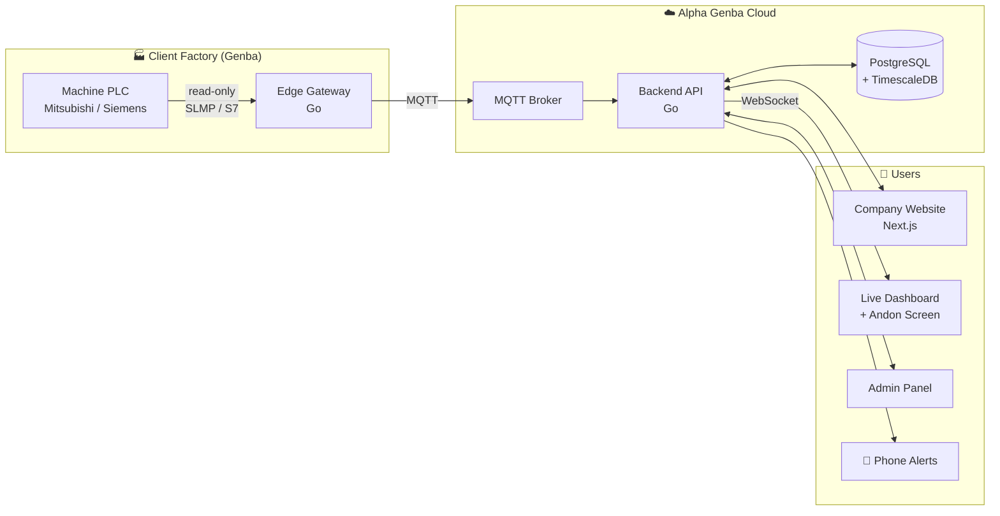
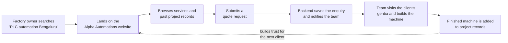
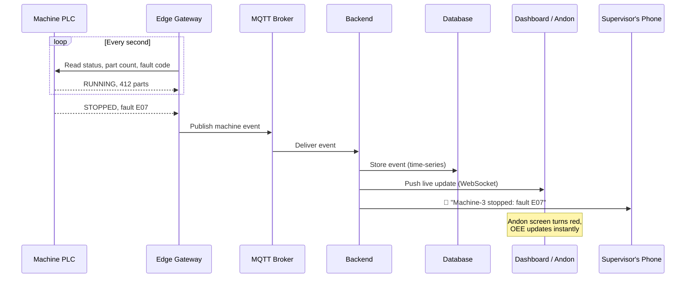
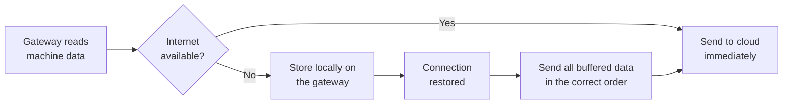

<div align="center">

# Alpha Genba

### Showcase the work. See the shop floor live.

A full-stack industrial software platform built for **Alpha Automations**,<br/>
an industrial automation equipment manufacturer in Bengaluru, India.


</div>

> **Genba (現場)** is a Japanese manufacturing term meaning *"the actual place"*, the shop floor where real work happens. It comes from the Toyota Production System, where problems are solved by going to the genba and seeing them first-hand.

---

## Why This Project Exists

**Alpha Automations** designs and manufactures complete automated and semi-automated machines and PLC-controlled electrical control panels for industries of every kind. Their approach is genba-first: the team goes to the client's shop floor, studies the real difficulty, and builds a machine that solves it, for **consistency** and **maximum output**.

But two problems remain once the hardware is built:

| Problem | Impact |
|---|---|
| The company's work is not visible online | New clients cannot see what Alpha Automations has built or what it can do |
| Once a machine is installed, nobody sees how it performs | Stoppages go unnoticed, quality issues are not tracked, output is lost |

**Alpha Genba solves both, in one platform.**

---

## The Platform

<table>
<tr>
<td width="50%" valign="top">

### 🌐 Part 1: Company Website

For **new clients** and the **Alpha Automations team**

- Services and capabilities
- **Project records**: every machine delivered, with the genba problem, the solution built, and photos
- Industries served
- **Request a quote**: enquiries go straight to the team
- **Admin panel**: add projects and manage enquiries without code

</td>
<td width="50%" valign="top">

### 🏭 Part 2: Live Monitoring

For **clients** running Alpha Automations machines

- **Live machine status**: running, stopped, faulted
- **Digital Andon**: instant alert when a line stops
- **OEE**: Availability × Performance × Quality
- **Poka-Yoke and quality logs**
- **Production reports**: output, cycle time, downtime

</td>
</tr>
</table>

---

## System Architecture

Both parts share **one backend and one database**, so a project shown on the website and the machine running at the client's factory are part of the same system.



---

## How It Works

### Flow 1: A new client finds Alpha Automations



### Flow 2: A machine stops on the shop floor



### Flow 3: The factory internet goes down



No data is lost, even on unreliable factory networks.

---

## Engineering Highlights

| Challenge | Approach |
|---|---|
| **Talking to industrial hardware** | Edge gateway reads Mitsubishi PLCs (SLMP / MC protocol) and Siemens PLCs (S7) |
| **Safety on live production lines** | The platform is **read-only**: it never writes to a PLC |
| **Unreliable factory internet** | Store-and-forward buffering on the gateway |
| **Real-time updates** | MQTT from machines, WebSockets to the dashboard |
| **Large volumes of machine data** | Time-series storage with TimescaleDB |
| **One system, two audiences** | A shared Go backend serves both the public website and the monitoring dashboard |
| **Built on real manufacturing concepts** | OEE, Andon, Poka-Yoke, Genba from lean manufacturing and the Toyota Production System |

---

## Tech Stack

| Layer | Technology |
|---|---|
| Website and dashboard | TypeScript, React, Next.js, Tailwind CSS |
| Backend API | Go |
| Edge gateway | Go |
| Messaging | MQTT |
| Database | PostgreSQL + TimescaleDB |
| Real-time | HTTP polling today, WebSockets planned |
| DevOps | Docker, GitHub Actions, Linux |

---

## Project Structure

```
alpha-genba/
├── backend/     # Go: REST API, admin login, PostgreSQL access, live monitoring feed
├── simulator/   # Go: simulated factory (machines, faults, OEE) with tests
├── web/         # Next.js: company website, live dashboard, admin panel
├── gateway/     # (planned) Go: edge gateway that reads real PLC data
└── deploy/      # (planned) Docker and deployment configuration
```

---

## Run It Locally

You need **Go** and **Node.js**. PostgreSQL does **not** need to be installed: in development the backend downloads and starts its own PostgreSQL automatically (data is kept in `.devdata/`).

**1. Set the admin password** (first time only)

```bash
cp backend/.env.example backend/.env
```

Then open `backend/.env` and choose an `ADMIN_PASSWORD`. This file is ignored by Git.

**2. Start the backend** (terminal 1, from the repository root)

```bash
go run ./backend
```

The API runs on http://localhost:8080. Stop it with **Ctrl + C** so the database shuts down cleanly.

**3. Start the website** (terminal 2)

```bash
cd web
npm install
npm run dev
```

Open http://localhost:3000. The website forwards every `/api` request to the backend.

| Page | What it is |
|---|---|
| `/` | Home: services, genba approach, recent projects, live preview |
| `/projects` | Project records added from the admin panel |
| `/contact` | Request a Quote form (saved to PostgreSQL) |
| `/live` | Live monitoring demo: machine status, Andon, OEE |
| `/admin` | Admin panel: manage enquiries and projects |

**Run the tests**

```bash
go test ./...
```

## API

| Method | Path | Access |
|---|---|---|
| `GET` | `/api/health` | Public |
| `GET` | `/api/projects`, `/api/projects/{slug}` | Public (published only) |
| `POST` | `/api/enquiries` | Public (validated, rate-limited, spam honeypot) |
| `GET` | `/api/monitor` | Public (live demo snapshot) |
| `POST` | `/api/admin/login`, `/api/admin/logout` | Login is rate-limited |
| `GET` / `PATCH` | `/api/admin/enquiries[/{id}]` | Admin |
| `GET` / `POST` / `PUT` / `DELETE` | `/api/admin/projects[/{id}]` | Admin |

---

## Roadmap

| Phase | Website | Live Monitoring | Status |
|---|---|---|---|
| **0** | Project setup | Machine simulator | ✅ Done |
| **1** | Home, services, approach, contact | Simulator feeds the backend | ✅ Done |
| **2** | Project records, quote requests, admin panel | Live dashboard with OEE and Andon | ✅ Done |
| **3** | Real projects and photos, deployment | MQTT + WebSockets, real PLC integration, pilot at a client factory | ⚪ Planned |

---

## About Alpha Automations

*Moving forward.*

Alpha Automations is an engineering house providing complete industrial automation solutions across all industries:

- Equipment manufacturing: complete automated and semi-automated machines
- Electrical control panel manufacturing with PLC control
- Mitsubishi PLC (Q-Series and FX-Series), servo drives and VFDs
- Siemens PLC and drives
- Pneumatic logic and circuit solutions
- Control panel wiring and Poka-Yoke solutions
- Production control and monitoring (Andon)
- HMI interface and communication solutions (FL-net, Profibus)
- Screwing solutions
- Vision systems, scanner and printing solutions

---

## Author

Designed and built by **Vachana** for Alpha Automations.

[GitHub](https://github.com/Vachana7)
